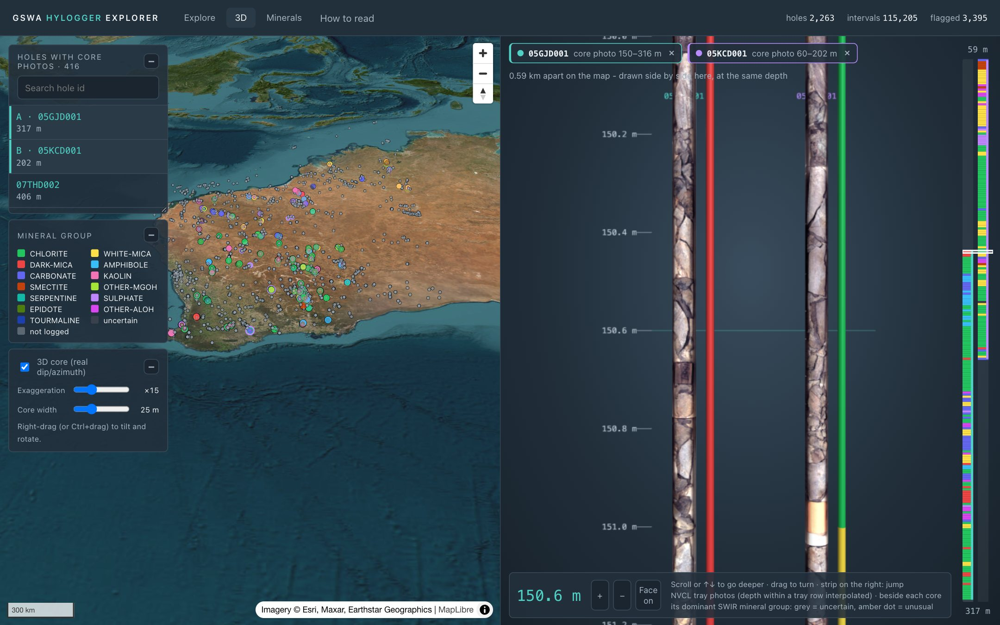
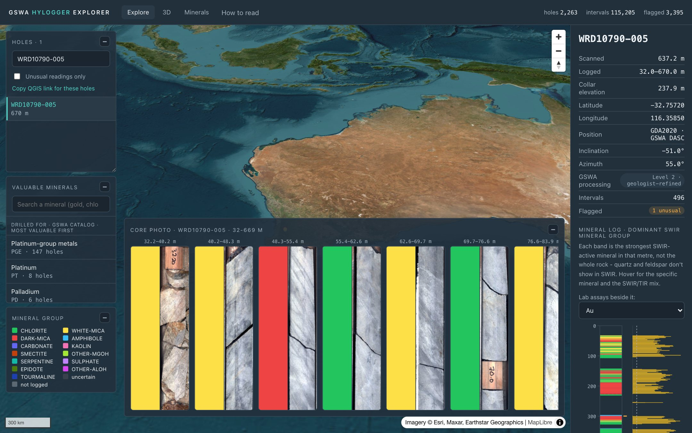
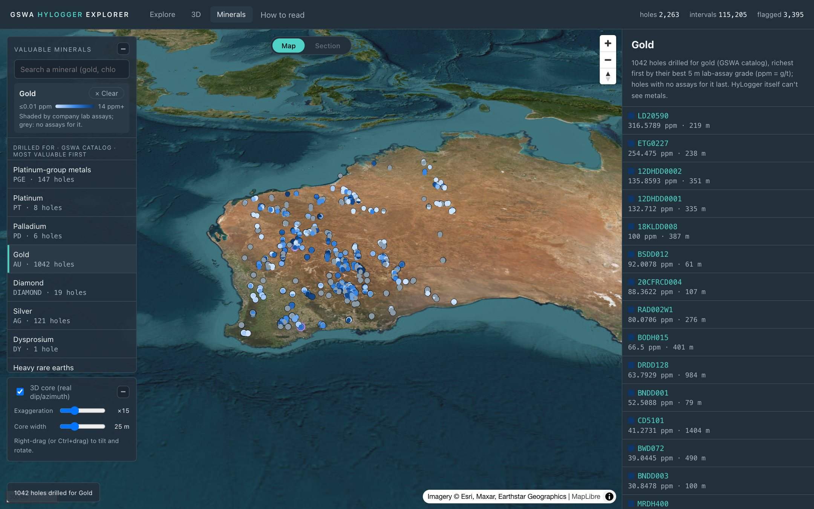
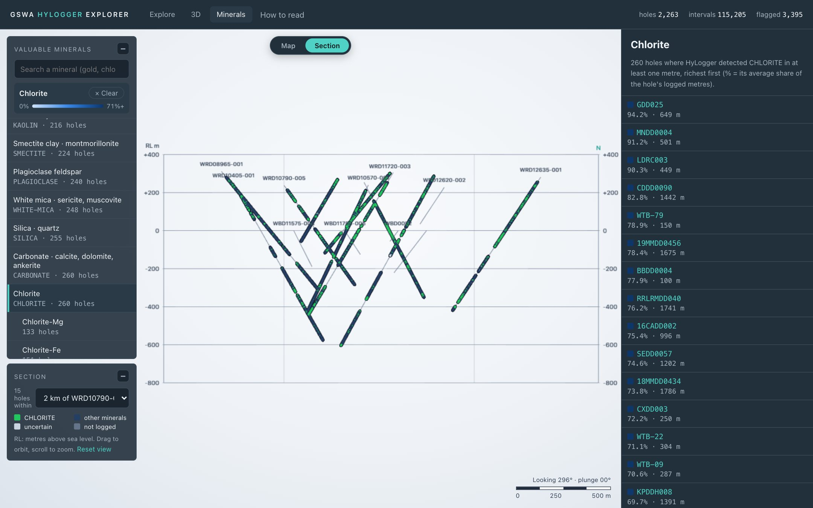
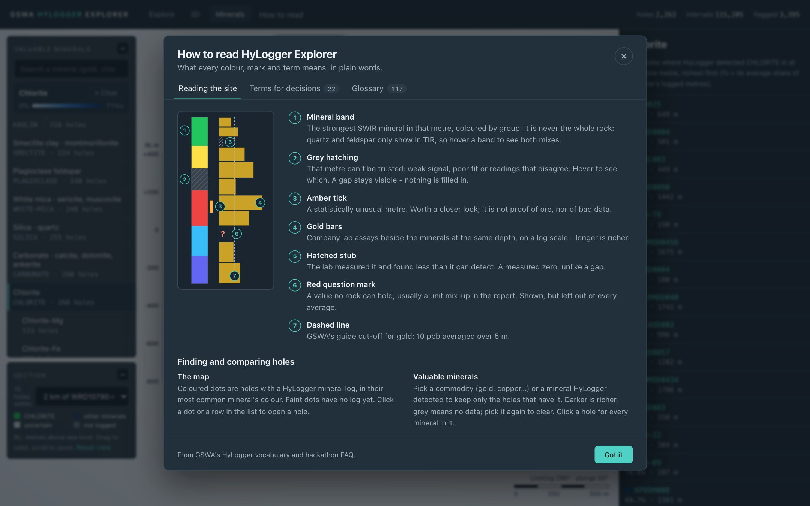

# HyLogger Explorer

A web app that makes GSWA's HyLogger mineral logs readable at a glance: on a
map, down a hole and in a section. Uncertain readings, lab assays and data
problems are shown rather than hidden.



_The 3D tab: two holes 0.59 km apart, compared at the same depth. Each core is its NVCL tray photos on a true-scale cylinder, with the dominant mineral group beside it and the full mineral log on the right._

| | |
|---|---|
| **Team** | The Hole Truth |
| **Leader (team captain)** | nhuannguyen87 |
| **Challenge theme** | Data Visualisation & Interactivity, drawing on Data Crunch and Data Adoption |

## The problem

HyLogger has scanned about 2,000 WA drill holes, metre by metre. The results
are hard for a geologist to approach, for three reasons:

- **The readings are in raw tables.** Each sample has mineral codes, weights
  and errors, and nothing on the page says which readings to trust.
- **The context lives elsewhere.** Company assays, collar surveys and GSWA's
  processing level each sit in a different database, sometimes with
  different names for the same hole.
- **The sources disagree.** Some hole positions are hundreds of kilometres
  apart between sources, and some assays carry impossible units.

A geologist wants three answers: which minerals are where, how far each
reading can be trusted, and how that compares with what the company assayed.

## What we built

- **Explore.** A satellite map of every HyLogger hole, each drawn in 3D at
  its real dip and azimuth. Click a hole to open:
  - its mineral log, with untrustworthy metres hatched grey and the reason
    given on hover;
  - the rock the company logged, beside the minerals on the same depth scale;
  - its company assays beside both;
  - its core tray photos, stitched into one strip.
- **Minerals.** Pick a commodity (gold, copper, nickel…) or a mineral
  HyLogger detected. The holes are shaded by their best 5 m assay grade or
  by the mineral's average share. **Section** then redraws the holes around
  one hole the way Leapfrog or Micromine show a deposit:
  - true dip and azimuth, at true scale both ways;
  - an RL grid, a scale bar, and the view bearing and plunge;
  - the chosen mineral in colour down every hole.
- **3D.** Each hole as a real drill core, with its tray photos wrapped round a
  cylinder at their true depths. Scroll down the hole, or compare two holes
  side by side.
- **How to read.** What every colour, mark and term means, from GSWA's FAQ
  and HyLogger vocabulary.
- **QGIS and CSV.** Every view is also a GeoJSON layer that QGIS opens from a
  URL. Any hole downloads as a per-metre CSV with its assays.

### Honest by design

- **A gap is not a zero.** Below detection, no assay and suspect units are
  drawn differently. A value no rock can hold (e.g. 421,300 ppm gold) is
  shown, but left out of every average.
- **Geologists' interpretations first.** Wherever GSWA has released a
  geologist-refined (Level 2) interpretation, the site reads it, and says
  which level each hole is.
- **Positions are cross-checked.** Each hole sits at GSWA's GDA2020 position
  wherever two of three sources agree: DASC, the company collar, and the
  NVCL catalog. 26 holes moved by more than 0.5 km (NDD1901 by 1,227 km).
  3 kept their NVCL position because DASC disagrees with the company collar
  (RKD005, a 6° longitude typo). 34 holes are marked "location checked".
- **Namesakes stay apart.** BH01 and BH01_Behemoth sit 1,250 km apart, so
  they never share assays, levels or positions.
- **"Unusual" means statistically unusual,** never "ore". An Isolation Forest
  flags metres unlike the rest of the data; a geologist decides what they mean.

### How it answers GSWA's challenge questions

These are the questions GSWA posed at the kickoff.

| GSWA's question | What the site does |
|---|---|
| Comparing drillholes | The section view draws every hole around one at true dip and scale; the 3D tab puts two cores side by side. |
| Drillhole interpretation consistency | Geologist-refined (Level 2) results are read wherever released, and every hole says which level it is. |
| Joining SWIR and TIR | Both mixes are shown for every metre, side by side, never added together. |
| Scalars to abundances | Each metre's mineral shares are weighted by TSA's Wt1–3, so a 60/40 chlorite–white mica mix stays 60/40. |
| Visualising downhole data on maps | Holes are shaded by their best 5 m assay grade, or by a mineral's average share down the hole. |
| Harmonising downhole data | Minerals, logged rock, assays and surveys share one depth scale. Where the logged rock is only a company code, the site says so. |
| Using additional data streams | Core tray photos, spectra, assays, collars and surveys sit beside the mineral log. |
| Uncertainty and data quality | Untrusted metres are hatched with the reason; below detection, gaps and suspect units are drawn differently. |

| Explore: one hole's minerals, assays and core photos | Minerals: holes drilled for gold, shaded by best 5 m grade |
|---|---|
|  |  |
| **Section: chlorite down each hole, other minerals navy** | **How to read: every mark explained** |
|  |  |

## HyLogger data used, and where to get it

None of this data is in the repo. `data/` and the DASC package folder are in
`.gitignore`; the screenshots above are the only derived figures committed.

| Data | What the site uses | Where to get it |
|---|---|---|
| GSWA HyLogger data (NVCL) | Each scanned metre's TSA mineral groups, weights, errors and signal-to-noise; core tray photos; spectra, fetched live | [AuScope NVCL services](https://geossdi.dmp.wa.gov.au/NVCLDataServices/) through [nvcl_kit](https://pypi.org/project/nvcl_kit/), the API in GSWA's FAQ (`download.py` does this). The same datasets are on [NCI THREDDS](https://thredds.nci.org.au/thredds/catalog/rs07/WA/catalog.html). |
| DASC HyLogger Drillhole Package (interim, GDA2020) | Dataset index: processing levels, GDA2020 positions, commodities, document links. WAMEX assays, downhole geology, WAMEX and WAPIMS collars, WAMEX surveys. | [DASC](https://dasc.dmirs.wa.gov.au/): search "HyLogger Drillhole Package", then unzip it into the project folder as `INTERIM_HyLogger_Dataset_Package_GDA2020_DB/` |
| GSWA HyLogger catalog and vocabulary workbook (optional) | Per-hole commodity and links; the 117-term vocabulary | Shared by GSWA with the UWA CITS5553 capstone; not public. Without them, the site takes commodities and links from DASC and shows our 22 FAQ-based term notes. |

The demo holes are listed in [`demo-holes.txt`](demo-holes.txt): 14 deep
holes near Boddington and 6 east of Kalgoorlie. Any NVCL WA hole name works.

## Install and run

You need macOS or Linux (on Windows, use WSL 2), an internet connection, and:

- [Docker Desktop](https://www.docker.com/products/docker-desktop/), running;
- Python 3.12 exactly, because the pinned scientific packages are built for
  it (`brew install python@3.12`; Ubuntu 24.04 already has it);
- Node.js 18 or newer.

The first run downloads about 1 GB: the PostGIS image and the Python and npm
packages.

1. Recommended: download the DASC package (link above) and unzip it into the
   project folder. Without it you get the 20 demo holes alone, with no
   assays, levels or extra holes.
2. Run the one-time setup. It starts PostGIS in Docker, installs the Python
   and npm packages, fetches the demo holes from NVCL (5 to 10 minutes),
   builds the per-metre data, loads it and trains the anomaly model.

   ```bash
   git clone https://github.com/nhuannguyen87/hackathon_hylogger.git
   cd hackathon_hylogger
   ./setup.sh
   ```

3. Start the API and the website, each in its own terminal tab.

   ```bash
   ./run-backend.sh
   ```

   ```bash
   ./run-frontend.sh
   ```

4. Open <http://localhost:3000>.

To add holes, list NVCL WA hole names one per line in a file, then fetch and
load them:

```bash
./get-data.sh my-holes.txt && ./reload-data.sh
```

If you add the DASC package after setup, run the same line without
`my-holes.txt`, so the demo holes' Level 2 results are read.

The backend tests run against a throwaway database:

```bash
cd backend && ../.venv/bin/python manage.py test holes
```

## How it is built

```
NVCL (nvcl_kit) ─ download.py ─ etl.py ─ files/extract.py ─ data/*.py ─┐
DASC package ──────────────────────────── load_interim ────────────────┤
                                                                        ▼
               Django REST + PostGIS (backend/) ─▶ Next.js + MapLibre + deck.gl (frontend/)
```

- `files/extract.py` collapses each metre's readings to one dominant SWIR
  mineral group. It also records how far that call can be trusted, from
  coverage, agreement, spectral fit and signal checks.
- `backend/holes/management/commands/load_interim.py` reads the DASC package:
  assays, processing levels and cross-checked positions.
- `backend/holes/assays.py` holds the assay rules: below-detection codes,
  unit ceilings, and the best 5 m length-weighted average.
- `frontend/components/SectionView.jsx` draws the section view.

Useful API endpoints (browse them at <http://localhost:8000/api/holes/>):

```
GET /api/holes/?commodity=AU            also &group=CHLORITE, &species=Chlorite-Fe
GET /api/holes/<id>/measurements/       the per-metre mineral log
GET /api/holes/<id>/assays/             assay intervals and best 5 m grades
GET /api/holes/<id>/geology/            the rock the company logged
GET /api/holes/<id>/export.csv          one row per metre, with logged rock and assays
GET /api/qgis/holes.geojson             QGIS layers: holes, intervals, assays
GET /api/minerals/richness/?commodity=AU
```

## Licence and attribution

- **Code:** MIT, see [LICENSE](LICENSE).
- **HyLogger data:** © State of Western Australia (Geological Survey of
  Western Australia, DMPE), CC BY 4.0, served through AuScope's National
  Virtual Core Library.
- **Assays, collars and surveys:** company data reported to WAMEX and
  WAPIMS, compiled in GSWA's interim DASC package (CC BY 4.0). GSWA did no
  quality control on them.
- **Basemap:** Esri World Imagery © Esri, Maxar, Earthstar Geographics.

## Use of AI tools

Built with Claude Code (Anthropic) as a coding assistant. The data rules
(what counts as below detection, suspect units, which positions to trust)
follow GSWA's hackathon FAQ and were checked against the data.
